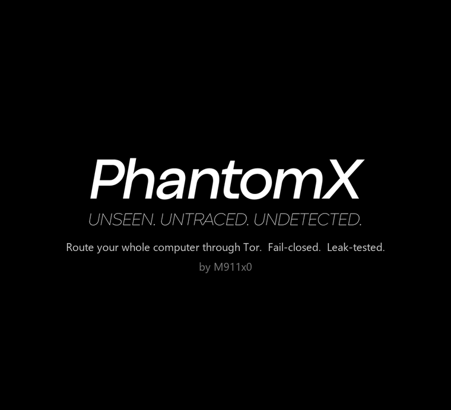
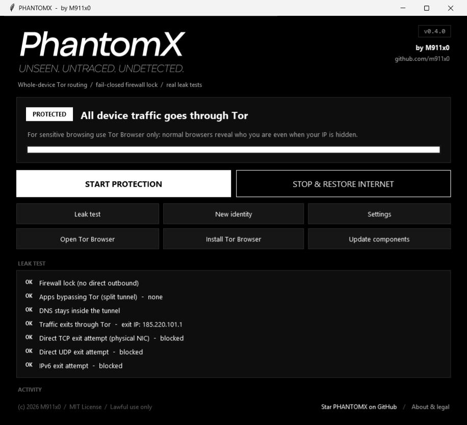
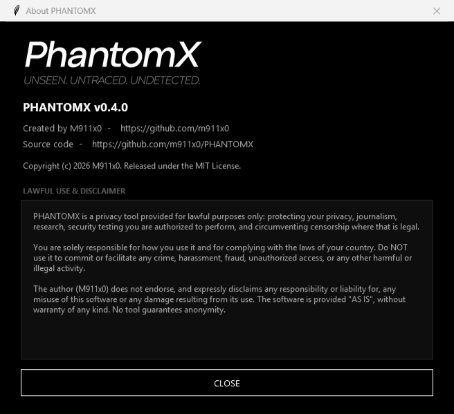

<div align="center">

<picture>
  <source media="(prefers-color-scheme: dark)" srcset="docs/logo-white.png">
  
</picture>

**Route your whole computer through Tor. Fail-closed. Leak-tested.**

[](LICENSE)


[](https://github.com/m911x0/PHANTOMX/actions/workflows/tests.yml)

Created by **[M911x0](https://github.com/m911x0)**



</div>

---

## Why PHANTOMX
Most "torify everything" scripts are Linux-only, and they quietly leak when Tor stops. PHANTOMX is different:

- **Whole device:** every app goes through Tor, including the ones that ignore proxy settings.
- **Fail-closed:** a firewall lock blocks every other path. If Tor stops or the tool crashes, you go **offline**, never exposed.
- **Proves it:** after every start it actually *tries* to leak (direct TCP, UDP, IPv6, DNS), and every attempt must be blocked.
- **Verifies its own supply chain:** it checks Tor's OpenPGP signature itself, with no `gpg` needed.
- **Windows, macOS and Linux**, from one command.

```
every app ──► sing-box tunnel ──► tor ──► Tor network ──► internet
     │
     └──✗ every other path blocked by the firewall (fail-closed)
```

## Screenshots
<p align="center">
  
  
</p>

## Install
You need **Python 3.10+** and **pipx**.

**Windows** (PowerShell):
```powershell
py -m pip install --user pipx; py -m pipx ensurepath
```
```powershell
pipx install https://github.com/m911x0/PHANTOMX/archive/refs/heads/main.zip
```

**macOS**:
```bash
brew install pipx python-tk && pipx ensurepath
pipx install https://github.com/m911x0/PHANTOMX/archive/refs/heads/main.zip
```

**Linux** (Debian/Ubuntu; use your distro's equivalents):
```bash
sudo apt install pipx python3-tk nftables && pipx ensurepath
pipx install https://github.com/m911x0/PHANTOMX/archive/refs/heads/main.zip
```

## Run
```
phantomx
```
That's it. PHANTOMX asks for Administrator/root rights by itself (a UAC prompt on Windows, `sudo` on macOS/Linux) and opens the control panel. Press **START PROTECTION**. On first use it downloads and verifies its components automatically.

## What happens automatically
| Component | Source | Verification |
|---|---|---|
| tor (Tor Expert Bundle) | dist.torproject.org | SHA-256 must match Tor's `sha256sums-signed-build.txt`, whose OpenPGP signature is checked against the **Tor Browser Developers key pinned in PHANTOMX** (`EF6E 286D DA85 EA2A 4BA7 DE68 4E2C 6E87 9329 8290`) |
| sing-box 1.12.x | github.com/SagerNet/sing-box | SHA-256 must match the digest GitHub publishes |
| Tor Browser (**Install Tor Browser** button) | dist.torproject.org | the same signed hash list |

Nothing is used unless it verifies. Binaries live in a folder only Administrator/root can write:
- Windows: `C:\ProgramData\PhantomX`
- Linux: `/var/lib/phantomx`
- macOS: `/private/var/db/phantomx`

## What it protects
| Protection | How |
|---|---|
| Hides your IP and the location derived from it | all TCP goes through Tor |
| No DNS leaks | apps get FakeIP answers; names resolve inside Tor; `.onion` works |
| No UDP / WebRTC / QUIC / IPv6 leaks | blocked |
| Kill switch | the firewall allows only the tunnel; if anything stops you go **offline** |
| Tamper protection | every binary pinned by SHA-256 and checked at each start |
| Censored networks | bridges: obfs4, webtunnel, snowflake, meek |
| No browsing history on disk | sing-box logs only crashes; tor uses SafeLogging |

## What it does NOT do
- **It does not hide who you are inside a browser.** Your accounts, cookies and fingerprint still identify you. **Use Tor Browser for anything sensitive.**
- **It does not anonymize the OS itself:** OS telemetry goes through Tor (IP hidden) but still carries device identifiers.
- **It does not protect against malware** running as Administrator/root.
- **Nothing is 100%.** For the highest assurance use Tails or Whonix.

## Firewall lock per OS
| OS | Mechanism | After a crash | After a reboot |
|---|---|---|---|
| Windows | Windows Defender Firewall: default outbound Block | stays locked (offline) | **stays locked**: open PHANTOMX and press Stop |
| Linux | nftables table `inet phantomx`, output policy drop | stays locked (offline) | lock is gone (normal network) |
| macOS | pf anchor `com.apple/phantomx` | stays locked (offline) | lock is gone (normal network) |

## Command line
`phantomx <command>`:

| Command | What it does |
|---|---|
| `start` / `stop` | start protection / stop and restore normal networking |
| `status` / `check` / `logs` | show state / run the leak tests / show recent logs |
| `newnym` | new Tor circuits for new connections |
| `setup` / `install-browser` | download, verify and install components / Tor Browser |
| `mode balanced\|strict` | speed vs. maximum isolation |
| `bypass list\|add PATH\|remove PATH` | split tunnel (those apps use your **real IP**) |
| `bridges --file F` / `bridges --off` | use or stop using bridges |

To get your internet back without the GUI:
```
phantomx stop
```

## Troubleshooting
- **Logs** (admin/root only): `<install folder>/run/`, or run `phantomx logs`.
- **GUI logs:** `<temp>/phantomx-gui.log` and `<temp>/phantomx-gui-error.log`.
- **Linux GUI under `sudo` on Wayland:** if no window appears, run `xhost +SI:localuser:root` once per session, or use the CLI.

## Legal
PHANTOMX is for **lawful use only**. The author does not endorse and **disclaims all liability for any misuse**. Read [DISCLAIMER.md](DISCLAIMER.md) before use.

## Author
Built by **M911x0**:
- GitHub: https://github.com/m911x0
- If PHANTOMX helps you, **star the repo**. It helps others find it.
- Security issues: please report them privately (see [SECURITY.md](SECURITY.md)).

## License
[MIT](LICENSE). Copyright (c) 2026 M911x0.

## Development
```
pip install -e .
python -m unittest discover -s tests -t .
```
Set `PHANTOMX_SINGBOX=/path/to/sing-box` to also validate generated configs with the real binary.
